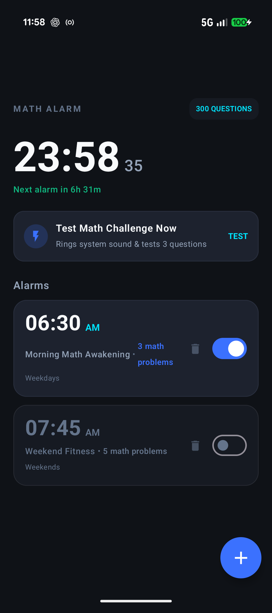
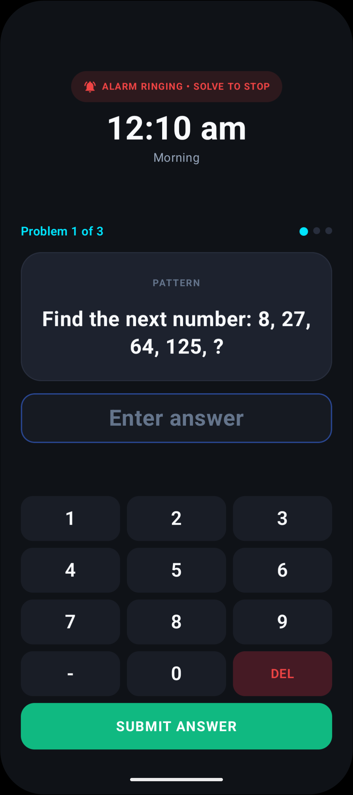
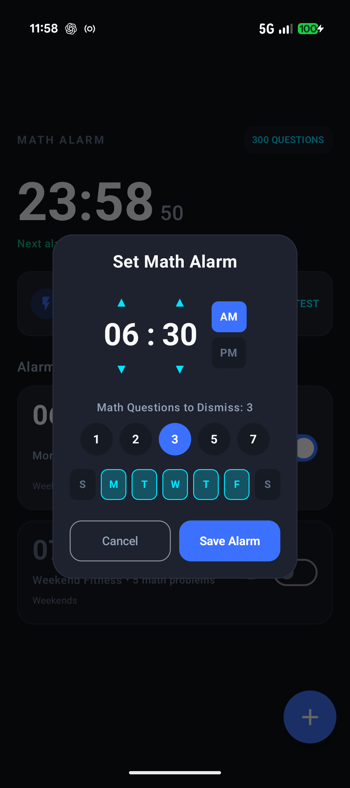

# ⏰ Math Alarm Clock (Android)

A modern, distraction-free, OLED-minimalist Android alarm clock app built with **Jetpack Compose**, **Material 3**, and **Kotlin 2.0**.

To stop the alarm, you must solve a sequence of **mind-focused math challenges and cognitive brain teasers** designed to awaken your brain—no scratchpad, notebook, or calculator required!

---

## ✨ Highlights

- **🧠 Mind-Focused Awakening (Not Tedious Paper Math)**:
  - 305 curated questions across **Cognitive Riddles**, **Number Patterns**, **Mental Shortcuts**, **Modular Logic**, and **Mental Balances**.
  - No brute-force multiplication: designed to test intuition, logic, and mental math.
  - **Zero Repetition**: Solved questions are tracked in persistent storage and never repeat until all 305 are cycled through.
- **⚡ System Alarm Audio & High-Priority Wakeup**:
  - Uses the system's native alarm sound (`RingtoneManager.TYPE_ALARM`) streamed via `AudioAttributes.USAGE_ALARM`.
  - Continuous looping audio & pulsating vibration.
  - Wakes up the phone from sleep and displays over the keyguard (`setShowWhenLocked`, `setTurnScreenOn`, `AlarmManager.setAlarmClock`).
- **🎨 Minimalist OLED Dark UI**:
  - Deep obsidian theme (`#0F1217`) with royal blue & electric cyan neon accents.
  - Live digital clock with second ticker and next alarm countdown.
  - Custom built-in tactile on-screen numeric keypad.
  - Instant **"Test Math Challenge Now"** card to test challenges and alarm sound anytime.
- **🛡 Anti-Cheat Protection**:
  - Back button is intercepted during alarm ringing.
  - Alarm sound and vibration only stop once all required problems are solved correctly.

---

## 📸 Screenshots

| Minimal Home Screen | Math Challenge Ringing | Add Alarm Dialog |
|:---:|:---:|:---:|
|  |  |  |

---

## 🧩 Categories of Mind Questions

1. **Cognitive Riddles & Brain Teasers**: Classic cognitive reflection tests, handshakes, exponential lily pad doubling, and snail problems.
2. **Patterns & Sequences**: Finding the next number in cubic, geometric, Fibonacci, prime, and polynomial sequences.
3. **Mental Shortcuts**: Difference of squares ($a^2 - b^2$ where $a+b=100$), rapid $\times 11$, $\times 25$, and squares of numbers ending in 5 ($85^2 = 7225$).
4. **Smart Mental Algebra**: Two-equation balances ($x+y=S, x-y=D$), proportional scaling, and averages.
5. **Number Sense & Modulo**: Units digits of powers, prime number properties, and modular remainders.

---

## 🛠 Tech Stack

- **UI**: Jetpack Compose, Material 3, Compose BOM 2024.12.01
- **Language**: Kotlin 2.0.21
- **Build System**: Gradle 8.13, Android Gradle Plugin 8.8.2
- **Architecture**: Modern Android architecture with Foreground Services, BroadcastReceivers, and exact `AlarmClockInfo` scheduling.
- **Target OS**: Android 8.0 (API 26) through Android 15/16 (API 35+).

---

## 🚀 Building & Running

### Prerequisites
- Android Studio or Android SDK Command-line Tools (API 35)
- Java 21

### Build APK
```bash
./gradlew assembleDebug
```
The output APK will be located at:
`app/build/outputs/apk/debug/app-debug.apk`

### Install on Device via ADB
```bash
adb install -r app/build/outputs/apk/debug/app-debug.apk
```

---

## 📄 License

MIT License. Designed & developed with clean modern Android best practices.
